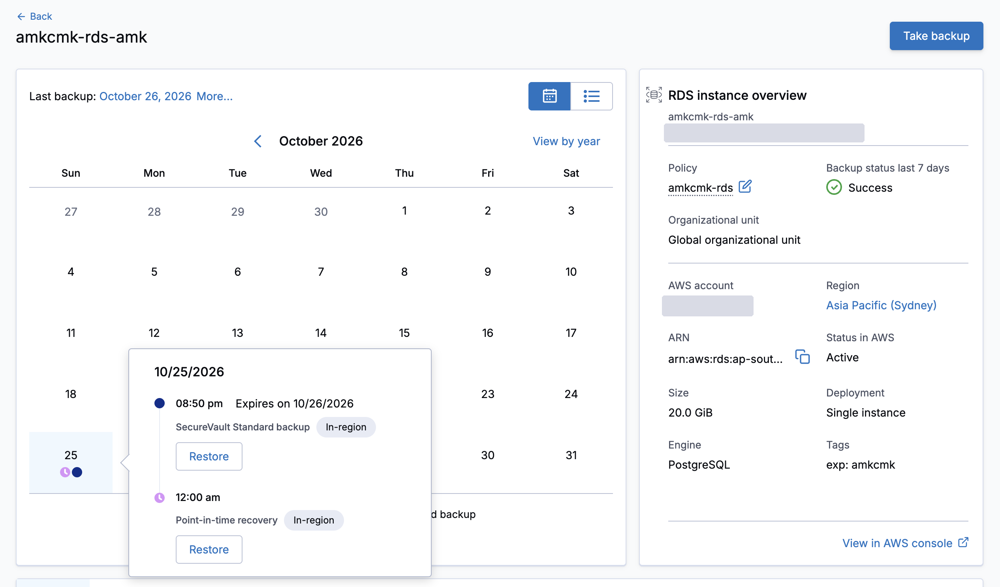

# Clumio and AWS encryption keys: a lab proof

**Clumio backs up and restores S3, RDS and EC2 data encrypted with AWS-managed keys and with customer-managed keys. The key stays in KMS.**

Clumio's IAM role in your account asks the AWS service to read the data, and the service asks KMS to decrypt it. No key is handed over. This repository is the Terraform, scripts and raw AWS evidence from a lab run, so you can check the claim instead of trusting it.



This is a companion to [Get started with Clumio on AWS](https://github.com/ntcsteve/get-started-clumio-aws). That kit sets Clumio up. This repository shows how it behaves with your keys.

## Choose your path

| You want to | Go to | You need |
|---|---|---|
| Check the claims without an AWS account | [Verify](#verify-it), then [docs/PROOF.md](docs/PROOF.md) | A terminal |
| Understand the mechanism | [docs/how-it-works.md](docs/how-it-works.md) and [docs/MAP.md](docs/MAP.md) | Nothing |
| Review what Clumio's role can do in an account | The kit's [SECURITY.md](https://github.com/ntcsteve/get-started-clumio-aws/blob/main/SECURITY.md), and `scripts/show-role.sh` for a live read-only view | Nothing to read; an AWS sign-in to run the script |
| Repeat the lab in a test account | [Reproduce it](#reproduce-it) | A test AWS account, a Clumio account and token |

## What was shown

| Service | AWS-managed key | Customer-managed key | Restore |
|---|---|---|---|
| S3 | `aws/s3`: backed up | backed up in the same backup | byte for byte, same Region and another Region |
| RDS | `aws/rds`: backed up | backed up | new encrypted instance, same account, same and another Region |
| EC2 | `aws/ebs`: backed up | backed up | encrypted again when the request names the source key (AWS-managed or customer-managed) |

- **A customer-managed key policy decides.** A policy that names Clumio's role: the object is backed up. An explicit Deny: Clumio reports the failed object with the AWS error.
- **RDS and the AWS-managed key.** AWS does not allow sharing a snapshot under `aws/rds`. Clumio copies the snapshot under a key that can be shared and shares the copy. CloudTrail shows each call.
- **Nothing changed on the keys in the main run.** The AWS-managed key policies already allow principals in the account to use the key through the service, and no key policy was edited for Clumio.

Scope: one test account, Clumio SecureVault Standard, S3, RDS (Postgres) and EC2. What the run did not prove is listed in [docs/PROOF.md](docs/PROOF.md#what-this-does-not-prove).

## Verify it

No AWS account is needed. You need a terminal with `shasum`.

```bash
scripts/verify-evidence.sh      # every evidence folder against its checksums
```

It ends with `RESULT: OK`. Then read [docs/PROOF.md](docs/PROOF.md): each claim has the command, the answer and the raw file.

## What is in here

| Folder | What |
|---|---|
| `docs/` | The proof (`PROOF.md`), the mechanism (`how-it-works.md`), a map of who calls what (`MAP.md`), images |
| `evidence/` | Raw captures from the lab run, sanitized, one folder per capture with a checksum file |
| `terraform/` | The lab, one folder per step (`00-connect` to `31-ec2-protect`) |
| `scripts/` | Setup, capture, restore and check scripts |
| `check.sh` | Checks this repository itself, offline. Run it before every commit |

## Reproduce it

This creates billable resources (EC2 and RDS instances, a bucket, KMS keys) and IAM roles for Clumio. Use a test account only.

You need:

1. Terraform 1.5 or later, the AWS CLI, `jq` and `shasum`. The scripts target macOS. On Linux, replace `date -u -v-24H` with `date -u -d '24 hours ago'`.
2. An AWS sign-in to the test account.
3. A Clumio API token and API URL. Set them as environment variables as in the kit's [Before you begin](https://github.com/ntcsteve/get-started-clumio-aws#before-you-begin), so the token never lands in a file.

Then:

1. `scripts/setup.sh` creates `lab.auto.tfvars` from the example. Set your `account_id` there, and run it again.
2. Follow [terraform/README.md](terraform/README.md): the apply order, the capture scripts, and the teardown order. It also says which Clumio connection the cross-Region restores need.

The Clumio modules come from the kit, pinned to a tag.

## Not an official Clumio product

This is an independent lab write-up, not an official Clumio or Commvault product or statement. Clumio is a trademark of its owner. For questions about the service, contact Clumio support. For this repository, open an issue.

Changing this repository, or using an AI agent with it? Read [AGENTS.md](AGENTS.md) first.

[Apache-2.0](LICENSE).
