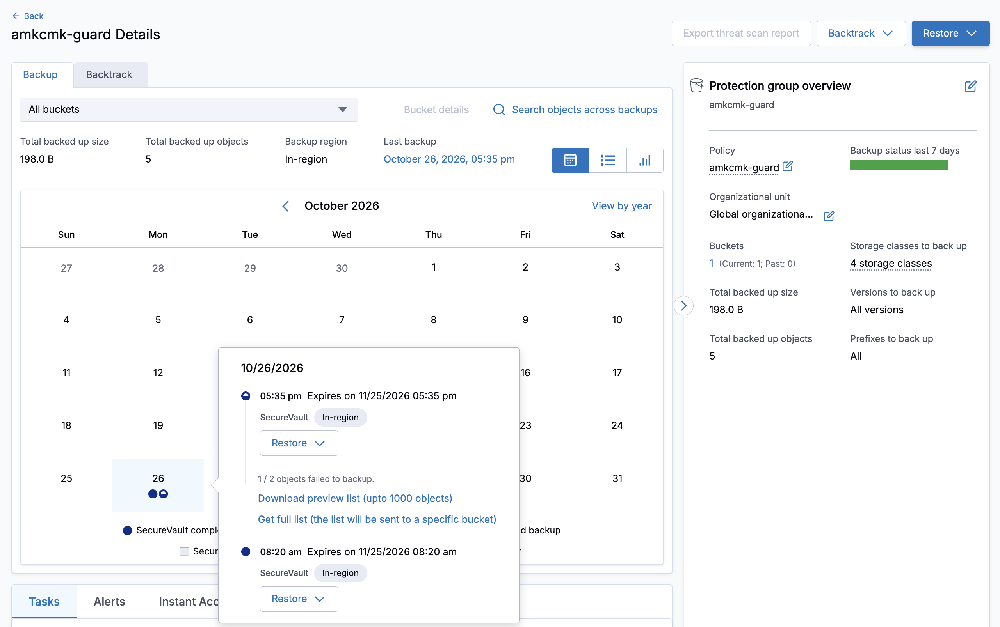

# Proof pack: Clumio backs up AWS-managed (AMK) and customer-managed (CMK) encrypted data

For a skeptical AWS engineer. Each claim has the command you can run, the answer we got, and the raw file we saved with a sha256 manifest.

The rules below are followed throughout.

## Rules this pack follows

1. Every claim names its scope: what was searched, where, and when.
2. "Every", "exactly", "no" and "none" appear only with the query that enumerates the whole scope.
3. Numbers and IDs come from the raw files. None is typed from memory.
4. Anything we did not prove is labelled **INFERRED**.
5. A claim with no saved raw file is not a claim.

## What was tested

Account `111111111111`, Region `ap-southeast-2` (one restore also into `ap-southeast-1`), Clumio SecureVault Standard, S3, RDS (Postgres 18.3) and EC2 (two t3.micro instances), on 2026-10-25 to 2026-10-27. The limits are in [What this does not prove](#what-this-does-not-prove). Read them before quoting any claim.

**Canonical captures** (index: `evidence/INDEX.md`): `evidence/s3-20261025T130001Z/`, `evidence/rds-20261025T131402Z/`, `evidence/review-fixes-20261025T134621Z/`, `evidence/review2-fixes-20261025T135941Z/`.

## The claims

| # | Claim | Status |
|---|---|---|
| C1 | An S3 object encrypted with the AWS-managed key `aws/s3` was backed up by Clumio | Proven |
| C2 | An S3 object encrypted with a customer-managed key was backed up in the same backup | Proven |
| C3 | An RDS instance encrypted with the AWS-managed key `aws/rds` was backed up by Clumio | Proven |
| C4 | An RDS instance encrypted with a customer-managed key was backed up by Clumio | Proven |
| C5 | The S3 backup restores byte for byte, in the same Region and in another Region | Proven |
| C6 | We changed no key policy for Clumio. Clumio's role caused RDS to create grants on our CMK, and the grantee of each is an AWS service, not a Clumio principal | Proven, scoped below |
| C7 | The RDS backups of an AMK database and of a CMK database each restore into a new, available, encrypted instance (unseeded databases, same account) | Proven |
| C8 | Clumio's role decrypted the S3 objects with the AWS-managed key and with our CMK, through S3 | Proven, scoped below |
| C9 | For RDS, Clumio does not share the AWS-managed snapshot. It shares a re-encrypted copy | Proven, scoped below |
| C11 | An EC2 instance whose root volume uses the AWS-managed `aws/ebs` key, and one using a customer-managed key, were each backed up by Clumio | Proven |
| C13 | With a key policy that names Clumio's role, the object is backed up; with an explicit Deny, the object is not backed up and Clumio reports the failure with the AWS error | Proven, scoped below (timestamp match inferred) |
| C12 | An EC2 restore returns an unencrypted volume unless a key is named; naming the source key (including `aws/ebs`) restores it encrypted under that key | Proven |
| C10 | The RDS backups restore into another Region when the request names a destination-Region key, subnet group and security group. Without them Clumio uses the source's values and refuses | Proven, scoped below |

## C1 to C4: which key each resource uses

AWS states these facts and we cannot set them: `KeyManager`, the reserved alias (customers cannot create aliases that begin `alias/aws/`), the key policy AWS wrote, and the tag our Terraform put on our own keys.

```
aws s3api head-object --bucket amkcmk-s3-111111111111-ap-southeast-2 --key amk.txt --query SSEKMSKeyId
aws rds describe-db-instances --db-instance-identifier amkcmk-rds-amk --query 'DBInstances[0].[StorageEncrypted,KmsKeyId]'
aws kms describe-key --key-id <that key>
aws kms list-aliases --key-id <that key>
aws kms list-resource-tags --key-id <that key>
aws kms get-key-policy --key-id <AMK key id> --policy-name default      # by key id; an alias is refused
```

| Resource | Key | `KeyManager` | Alias | Tag `exp=amkcmk` |
|---|---|---|---|---|
| S3 `amk.txt` | `eaf9bce5-...` | AWS | `alias/aws/s3` | none |
| S3 `cmk.txt` | `73899fa8-...` | CUSTOMER | none | yes |
| RDS `amkcmk-rds-amk` | `f07e156d-...` | AWS | `alias/aws/rds` | none |
| RDS `amkcmk-rds-cmk` | `c303ff3d-...` | CUSTOMER | none | yes |

Both RDS instances report `StorageEncrypted = true`. In each AWS-managed key policy, the statement for `Principal: *` is conditioned on `kms:ViaService` = `s3.ap-southeast-2.amazonaws.com` (`aws/s3`) or `rds.ap-southeast-2.amazonaws.com` (`aws/rds`), and on `kms:CallerAccount` = our account. A second statement gives our account root direct metadata actions (Describe, Get, List and similar).

**Raw files:** `evidence/s3-20261025T130001Z/` and `evidence/rds-20261025T131402Z/` hold `head-*`, `db-*`, `alias-*`, `tags-*` and `policy-aws-managed-key.json`. The `key-*.json` files there are three-field summaries of `describe-key`. The full responses are in `evidence/review-fixes-20261025T134621Z/` (`amk-describe-key-full-*.json`, `cmk-describe-key-full-*.json`).

## C1 to C4: Clumio backed each one up

| Resource | Backup record (Clumio API) | Clumio task |
|---|---|---|
| S3 group `amkcmk-s3` | `backed_up_object_count 2`, `failed_object_count 0`, `missing_object_count 0`, `backed_up_size_bytes 70` | task 4043628574, `completed`, no error |
| RDS `amkcmk-rds-amk` | type `aws_rds_resource_rolling_backup`, `kms_key_native_id` ends `key/f07e156d-...` (the `aws/rds` key) | snapshot task `completed` |
| RDS `amkcmk-rds-cmk` | same type, `kms_key_native_id` ends `key/c303ff3d-...` (our CMK) | snapshot task `completed` |

For the RDS run, `evidence/rds-20261025T131402Z/tasks.json` lists five Clumio tasks, all `completed`: two snapshot (backup) tasks, two PITR configuration syncs and one rule creation.

The S3 total of 70 bytes equals the two files' sizes added together (30 + 40, counted from the literal text), so the content of both objects was read.

**Raw files:** `evidence/s3-20261025T113828Z/backups.json`, `evidence/rds-20261025T131402Z/backups-*.json`.

## C8: Clumio's role decrypted the S3 objects with both keys

CloudTrail, searched by `EventName=Decrypt` for 11:30 to 11:45 UTC (the S3 backup ran at 11:35:20 to 11:37:29), keeping events whose identity contains `Clumio`, returns two events, both at 11:36:56:

| Key | S3 object (from the event's encryption context) | Made by |
|---|---|---|
| `eaf9bce5-...` (`aws/s3`) | `amk.txt` | role session `amkcmk-ClumioIAMRole-ase-2/daebaksrv-S3Backup`, `invokedBy fas.s3.amazonaws.com` |
| `73899fa8-...` (our CMK) | `cmk.txt` | same |

`fas.s3.amazonaws.com` is S3 acting on the role's behalf (a forward access session). This is the KMS log of the AWS-managed S3 key being used for Clumio's role.

**Raw file:** `evidence/review-fixes-20261025T134621Z/s3-kms-decrypt-events.json`. An earlier draft said no such event existed. It searched by `ResourceName`, which does not index these events.

## C9: RDS, what Clumio did, and who did it

Clumio re-encrypts a copy under a key in another account and shares only that copy. CloudTrail, in our account, saved in `evidence/rds-cloudtrail-20261025T131205Z/` (search: the four snapshot event names, 4 hours, requests naming our databases or Clumio's snapshots):

| Time (UTC) | Made by | API call | Detail |
|---|---|---|---|
| 12:50:57 | role session `amkcmk-ClumioIAMRole-ase-2/Denali-createRDSCustomerSession` | `CreateDBSnapshot`, both databases | `clumio-airgap-to-encrypt-...`, under the database's own key |
| 12:55:30 to :31 | same role session | `CopyDBSnapshot`, both | to `clumio-airgap-encrypted-...` with `kmsKeyId` `arn:aws:kms:ap-southeast-2:222222222222:key/32b305a5-...` |
| 12:58:03 to :04 | same role session | `ModifyDBSnapshotAttribute`, both | `restore` plus `222222222222`, on the **encrypted** copies |
| 13:01:13 to :15 | same role session | `DeleteDBSnapshot`, both | the `to-encrypt` snapshots |

**Scope of "not shared":** in that search window, CloudTrail holds no `ModifyDBSnapshotAttribute` event for a `to-encrypt` snapshot (the AWS-managed one); the only shares are of the re-encrypted copies. AWS itself refuses to share a snapshot encrypted with `aws/rds`, so this shows that Clumio's steps avoid the question, not that a share was tried and refused. The `to-encrypt` snapshots were deleted at 13:01.

**Not made by Clumio's role.** Two `CopyDBSnapshot` calls in our account at 12:58:36 and 12:58:38 were made by account `222222222222` itself (`userIdentity.type` `AWSAccount`, user agent `APN/1.0 Commvault/1.0 CDF/1.0 APN_1.1/pc`). Raw: `evidence/review-fixes-20261025T134621Z/copies-made-by-account-222222222222.json`. The same user agent also appears on the calls made by Clumio's own role session (`rds-cloudtrail-20261025T131205Z/CopyDBSnapshot.json`), so it ties these calls to Commvault software, not to a particular account. It fits `222222222222` being Commvault's own account. AWS records the request parameters of those two calls as hidden (`HIDDEN_DUE_TO_SECURITY_REASONS`), so their source and target are not visible to us. The user agent is supplied by the caller, so the identity of `222222222222` is a hint, not a confirmation (**INFERRED**).

**Three accounts act in this flow** (raw: `evidence/review2-fixes-20261025T135941Z/`):

| Account | What the evidence shows | Whose |
|---|---|---|
| ours (`****1111`) | owns the databases, the keys and the Clumio role | ours |
| `****3333` | the Clumio role's trust policy names `role/ClumioCustomerProtectRole` in this account; in the S3 backup window all 7 `AssumeRole` calls on the role came from it | **INFERRED** Commvault's control plane |
| `****2222` | holds the vaulted copy and the key `32b305a5`; made two `CopyDBSnapshot` calls in our account | **INFERRED** Commvault's |

```
aws rds describe-db-snapshots --snapshot-type manual
aws rds describe-db-snapshot-attributes --db-snapshot-identifier <snapshot>
aws cloudtrail lookup-events --lookup-attributes AttributeKey=EventName,AttributeValue=CopyDBSnapshot
```

| Snapshot (Clumio) | Database | Encrypted with | Shared with |
|---|---|---|---|
| `clumio-airgap-to-encrypt-...` | AMK | `aws/rds` key `f07e156d-...` (our account) | nobody |
| `clumio-airgap-to-encrypt-...` | CMK | our CMK `c303ff3d-...` | nobody |
| `clumio-airgap-encrypted-...` | both | key `32b305a5-...` in account `222222222222` | `222222222222` |

The AMK and the CMK database follow the same steps. Raw: `evidence/rds-20261025T125926Z/snapshots.json` (all four snapshots), `snapshot-shared-*.json`.

**The AMK itself was used.** CloudTrail shows a KMS `CreateGrant` on the `aws/rds` key `f07e156d-...` at 12:55:31 UTC by the Clumio role session, `invokedBy rds.amazonaws.com`, grantee the RDS service. For RDS this grant, and the snapshot encrypted under the key, are the evidence of use; unlike S3 (C8) we have no `Decrypt` event attributed to Clumio. Raw: `evidence/kms-cloudtrail-20261025T132702Z/aws-rds-key-events.json`.

## C7: RDS restore (same account)

Clumio restored each backup into a new instance (`amkcmk-rds-amk-r1`, `amkcmk-rds-cmk-r1`, tasks 4043872121 and 4043872163, about 11 minutes: 13:18:51 to 13:30:13 UTC). We named no key. AWS reports each restored instance under the same key as its source:

| Restored instance | Key | `KeyManager` | Alias | Status | Engine |
|---|---|---|---|---|---|
| `amkcmk-rds-amk-r1` | `f07e156d-...` | AWS | `alias/aws/rds` | available, encrypted | postgres 18.3 (source 18.3) |
| `amkcmk-rds-cmk-r1` | `c303ff3d-...` | CUSTOMER | none | available, encrypted | postgres 18.3 (source 18.3) |

CloudTrail in `evidence/rds-restore-20261025T131639Z/` shows the restore path: `CopyDBSnapshot` from `clumio-airgap-final-...` held in `222222222222` to `clumio-airgap-restored-...` in our account, encrypted with the source key (`f07e156d` for the AMK database, `c303ff3d` for the CMK one); then `RestoreDBInstanceFromDBSnapshot`; then `DeleteDBSnapshot` of the temporary copies.

**Limits:** same account and Region; unseeded databases (we loaded no data, never connected to them and did not inspect their content); no key named at restore. A cross-account restore cannot reuse the source's `aws/rds` key, so it must name a destination key (`kms_key_native_id`, a documented field). That is untested.

## C10: RDS restore into another Region (Sydney to Singapore)

Clumio restored both RDS backups into Singapore (`amkcmk-rds-amk-sg1`, `amkcmk-rds-cmk-sg1`, tasks 4045261351 and 4045261475, 22:07:51 to 22:19:16 UTC). It took four attempts, all saved, and the failures are part of the finding. Clumio fills the destination from the source backup unless the request overrides it. The target Region must already be connected to Clumio: these restores ran through a connection that existed for Singapore before this lab, and `terraform/00-connect` connects only `ap-southeast-2`.

| Attempt | The request named | Result |
|---|---|---|
| 1 | no key, no network | HTTP 504, error 397 (gateway); nothing created |
| 2 | the same | HTTP 400, error 341, `invalid KMS key ID`: the **Sydney** `aws/rds` key |
| 3 | + Singapore's `aws/rds` key | key accepted; HTTP 400, error 341, `invalid subnet group name 'default'` |
| 4 | + our subnet group `amkcmk-subnets` + Singapore's default security group | accepted; both tasks `completed` |

| Restored instance | Key | `KeyManager` | Alias | Status | Engine |
|---|---|---|---|---|---|
| `amkcmk-rds-amk-sg1` | `e25b56b0-...` | AWS | `alias/aws/rds` | available, encrypted | postgres 18.3 (source 18.3) |
| `amkcmk-rds-cmk-sg1` | `e25b56b0-...` | AWS | `alias/aws/rds` | available, encrypted | postgres 18.3 (source 18.3) |

Both databases are under Singapore's AWS-managed key because **we named that key in the request**. Clumio did not choose it. The key type at restore is the caller's choice. The CMK database changed from a customer-managed to an AWS-managed key by our request, since our Sydney CMK cannot be used in Singapore and we created no CMK there.

CloudTrail in Singapore shows the restore path: `CopyDBSnapshot` to `clumio-airgap-restored-...` with `kmsKeyId` = Singapore's `aws/rds` key at 22:08:29 and :30, then `RestoreDBInstanceFromDBSnapshot` at 22:11:05. These calls were made by the role of Singapore's own Clumio connection (`ClumioIAMRole-ase-1-...`), not by our Sydney role.

**Limits:** unseeded databases; the same account; the API only (the console form was not tested); a Singapore CMK was not tried, so whether a customer key can be kept across Regions is untested.

**Raw files:** `evidence/rds-restore-sg-20261025T215531Z/`, `...T215749Z/`, `...T215812Z/` (attempts 1 to 3) and `evidence/rds-restore-sg-20261025T220728Z/` (attempt 4: request, task, restored instance, key, alias, CloudTrail).

## C11: EC2 backup with the AWS-managed EBS key

Two t3.micro instances, one variable (the root volume's key). Clumio backed both up with SecureVault Standard (policy `amkcmk-ec2`, 1 day), assigned directly through the Clumio API (our lab tenant had no free policy-rule slot; this is why `scripts/assign-ec2-policy.sh` exists).

| Instance | Root volume key (AWS) | `KeyManager` | Alias | Clumio backup |
|---|---|---|---|---|
| `amkcmk-ec2-amk` | `e8e3ab17-...` | AWS | `alias/aws/ebs` | 1, started 2026-10-26 08:30:54 UTC, expires 10-27 |
| `amkcmk-ec2-cmk` | `40ad4b6b-...` | CUSTOMER | none | 1, same |

Clumio tasks for the run: a seeding task and an indexing task per instance, all `completed` (4 tasks). In our account, Clumio's role made one snapshot per root volume at 08:30:58 UTC (tags `Vendor=Clumio`, `OperationType=EC2 Backup`), encrypted with the same key as its volume (`snapshots.json`): the AWS-managed snapshot stays in our account and is read there. **Raw files:** `evidence/ec2-20261026T090741Z/` (keys, aliases, the `aws/ebs` key policy, snapshots, Clumio backup records and tasks) and `evidence/ec2-assign-assign-20261026T083007Z/` (the assignment). An earlier capture with four failed Clumio calls (HTTP 400, wrong filter names) is kept as `evidence/ec2-20261026T090648Z/`.

## C12: EC2 restore: name the key, or the volume comes back unencrypted

| Restore | The request named | Result (AWS `describe-volumes`) | Tasks |
|---|---|---|---|
| E4b, instances `-r1` | no key | root volumes **`Encrypted false`, `KmsKeyId null`**, for both | 4047532853, 4047532898, completed in about 5 minutes |
| E4c, instances `-r2` | each backup's own key id | AMK: encrypted under **`aws/ebs`** (`e8e3ab17`, `KeyManager AWS`). CMK: encrypted under our CMK (`40ad4b6b`). Both instances running | 4047567734, 4047567755, completed in 2 minutes 23 seconds |

So an EC2 restore does not inherit the source key: name it in `ebs_block_device_mappings[].kms_key_native_id`. Naming the AWS-managed key's id was accepted, and the restored volume is under it. (For RDS, the restored instance kept its source key by default; EC2 differs.) **Raw files:** `evidence/ec2-restore-20261026T091033Z/` (E4b) and `evidence/ec2-restore-20261026T091706Z/` (E4c).

**Not proven for EC2: that the file we wrote survived the restore.** We tried to compare disk blocks of Clumio's snapshot with the restored volume (the scripts and folders for this attempt are not included in this repo). It could not settle the question, for three reasons: (1) a 512 KiB block holds much more than our file, and both instances kept running, so block hashes differ for unrelated reasons (0 of 3 matching blocks identical); (2) the restored instance has a new instance id, so its boot script may have written the same line again, which would fake a match; (3) Clumio deletes its own snapshots, so the first run's source snapshot was gone before a rerun. The result is NOT PASSED and is kept as found. A fair test needs data the boot script cannot recreate, and a way to read the file itself.

## C13: Strict key policies. Clumio uses a key that names its role, and reports an explicit Deny

Two customer-managed keys with tight policies protect one object each (`allowed.txt`, `denied.txt`) in a bucket in a second protection group (`amkcmk-guard`). The hardened key's policy lets Clumio's role use it through S3 with no IAM delegation. The other key's policy has an explicit Deny for that role.

| Object | Key | Clumio's result (backup record `2026-10-26T09:35:00Z`) | AWS evidence |
|---|---|---|---|
| `allowed.txt` | hardened `615aab0f` | backed up (1 object, 58 B) | CloudTrail `Decrypt` at 2026-10-26 22:36:57 UTC by session `daebaksrv-S3Backup` of the Clumio role, encryption context `allowed.txt` |
| `denied.txt` | explicit-Deny `d4029cb7` | **not backed up. Reported failed** (1 object, 57 B) | CloudTrail `Decrypt` with `errorCode` `AccessDenied` at 2026-10-26 22:36:57 UTC by the same role session on `d4029cb7`: "not authorized to perform: kms:Decrypt ... with an explicit deny in a resource-based policy" (`cloudtrail-Decrypt.json`). Clumio's skipped-objects list shows the same 403 (`clumio-skipped-objects-...csv`) |

So an explicit Deny in a key policy is honored and shown to the customer, and the other object in the same bucket is unaffected. The timestamps differ (record start 09:35, `Decrypt` 22:36): the match between them is INFERRED from the object, the role session and the key, not read from one record. **Raw files:** `evidence/guard-20261027T064458Z/` (`_summary.txt`, `backups.json`, `clumio-skipped-objects-20261026T0935Z.csv`, `cloudtrail-Decrypt.json`, both key policies). The earlier backup (`2026-10-26T00:20:18Z`, 4 objects) did not include the guard objects, so it decided nothing. `_summary.txt` in that folder lists only the successful call; the denied call is in `cloudtrail-Decrypt.json`, which is one 50-event page of CloudTrail results, not an exhaustive list.



## C5: S3 restore

Restored under a new prefix (`overwrite=false`) and compared sha256 with the hash of the literal text we wrote, not with a copy of our own output.

| Test | Result |
|---|---|
| Same Region, same bucket (E2a) | both files MATCH, task completed |
| New bucket in Singapore (E2c) | both files MATCH, task completed |

The restored copies are encrypted `AES256` (the destination bucket's default), not with the source key. Raw: `evidence/e2a-20261025T115029Z/`, `evidence/e2c-20261025T120423Z/`.

## C6: what Clumio was and was not given

Scope: the two keys and the one role below, read on 2026-10-25 at 13:46 UTC. Raw files are in `evidence/review-fixes-20261025T134621Z/`.

- **AMK key policies:** AWS wrote them and they cannot be edited. We did not touch them.
- **CMK key policy** (`cmk-key-policy-c303ff3d.json`): the AWS default. It has one statement, account root with `kms:*`, which delegates to IAM. No statement names Clumio.
- **Grants on the RDS CMK:** the live list at 13:46 UTC (`cmk-grants-c303ff3d.json`) has only the RDS service as grantee. CloudTrail `CreateGrant` events on that key since 10:00 UTC (`create-grant-events-on-rds-cmk.json`) include four made by Clumio role sessions (12:55:30, 13:19:28 and two at 13:22:05), each `invokedBy rds.amazonaws.com`; the grantee in these events is `rds.` or `ec2.ap-southeast-2.amazonaws.com`, never a Clumio principal. So Clumio's role causes the grants, and AWS services hold them. The S3 CMK `73899fa8` had no grants at 13:46.
- **No key policy was changed:** CloudTrail holds no `PutKeyPolicy` event in this account since 10:00 UTC (`put-key-policy-events-since-10utc.json`). The CMKs were created with the default policy (`CreateKey`), which is not a `PutKeyPolicy`.
- **Clumio's role `amkcmk-ClumioIAMRole-ase-2`** (kit-created): its inline `ClumioKMSPolicy` allows `kms:Decrypt`, `kms:Encrypt`, `kms:ReEncrypt*`, `kms:GenerateDataKey*` and `kms:DescribeKey` on `arn:aws:kms:*:*:key/*`. The attached `ClumioRdsBackupPolicy` and `ClumioRdsRestorePolicy` also allow `kms:CreateGrant` on `key/*`. Files: `role-inline-policy-*.json`, `role-attached-policy-*.json`.
- **These are IAM permissions, not key policy changes.** For the CMK the root statement delegates to IAM. For the AMK the key policy admits the account's principals through the owning service.

## Questions a skeptic will ask

| Question | Answer | Where |
|---|---|---|
| Is the "AMK" really AWS-managed? | `KeyManager AWS`, the reserved alias, AWS-written policy, no creator tag | C1 to C4 |
| You used root. Maybe root did the backup. | Our Terraform and CLI (root) created and deleted our test resources and ran read checks. The Clumio steps in C8 and C9 are role sessions of `amkcmk-ClumioIAMRole-ase-2`, plus two copies by account `222222222222` | C8, C9 |
| Maybe Clumio read the data unencrypted. | S3: the KMS log shows decrypt with both keys (C8). RDS: the storage and snapshots are encrypted, and the copy is re-encrypted under another key (C9) | C8, C9 |
| AWS forbids sharing an `aws/rds` snapshot. | In the search window no share of the AWS-managed snapshot exists; a re-encrypted copy was shared | C9 |
| Did you loosen any permission for Clumio? | No key policy changed. We did give Clumio's role IAM permissions through the kit: `kms:Decrypt`, `kms:Encrypt`, `kms:ReEncrypt*`, `kms:GenerateDataKey*`, `kms:DescribeKey` and `kms:CreateGrant`, on `key/*` for any key. That is the product's design, and it is a real grant of access | C6 |
| Is `222222222222` (or `333333333333`) Commvault's? | **INFERRED** for both. `222222222222` holds the vaulted copy and acted with user agent `APN/1.0 Commvault/1.0`; `333333333333` is the account the role trusts and the one that assumed it. Ask Commvault to confirm | C9, the actors table |
| Tiny data. At scale? | Not tested | limits |
| Could the evidence have been edited? | `scripts/verify-evidence.sh` catches a changed file. It cannot catch an added file or a regenerated manifest, so record its root hash somewhere we do not control. CloudTrail is AWS-held, and a reviewer can query it live within 90 days | `evidence/INDEX.md` |
| Does restore need the source key? | S3 across Regions: no. RDS same account: the restored instance keeps its source key. RDS across Regions: the source key cannot be used, so the request must name a destination-Region key. Cross-account: untested | C5, C7, C10 |

## What this does not prove

Say this first if challenged.

- **Nobody outside this team has re-run it.** Not independently re-run by a human AWS engineer. The lab is torn down; the Terraform and scripts in this repository build it again.
- **RDS restore used unseeded databases, in the same account.** Rows and cross-account are not tested. The EC2 restores were also same-account, and the file we wrote was not shown to survive them (C12).
- **Cross-account restore and "source account lost"** are not tested. Cross-Region (S3 and RDS) is. A customer-managed key kept across Regions is not tested.
- **Customer key control ends at the re-encryption.** The vaulted RDS copy is encrypted under a key in `222222222222` (`32b305a5`), not under the customer's key. Revoking the customer's key would, by inference (**INFERRED**), not stop Clumio reading its own copy. This was not tested either way.
- **A hardened CMK policy** (without the account-root delegation statement) is tested for S3 only (C13). The RDS and EC2 keys use the AWS default policy.
- **Negative control:** C13's explicit Deny shows that a refused key stops an S3 backup visibly. We did not revoke access for RDS or EC2.
- **Scale:** two 30 and 40 byte files and two unseeded databases (20 GiB allocated) and two t3.micro instances; one backup each; one retention (30 days S3, 1 day RDS); one Region pair; SecureVault Standard only.
- **The identities of accounts `222222222222` and `333333333333`** are inferred.
- **A `kms_key_native_id` in Clumio's record** shows the key Clumio recorded, not what Clumio did with it.
- **Docs gap:** no Commvault page states AMK support. This is lab evidence, not a vendor guarantee. Ask for a written statement.

## What would prove us wrong

- A `KeyManager` of `CUSTOMER` on an `alias/aws/*` key, or `AWS` on `c303ff3d-...`.
- A Clumio backup record with `failed_object_count > 0`, or a task that did not complete.
- A key policy statement or grant that names a Clumio principal on our CMK.
- A completed RDS backup with no `clumio-airgap-encrypted-...` copy in our account, which would mean a different mechanism.
- A manifest mismatch: `scripts/verify-evidence.sh`.

## Reproduce it

```
scripts/demo-proof.sh          # live, read-only: keys, S3 Decrypt events, RDS snapshot calls, who made them
scripts/verify-evidence.sh     # offline: every evidence folder against its checksums, and a root hash
```
`demo-proof.sh` searches the last 48 hours by default (`PROOF_HOURS=n` widens it; CloudTrail Event history keeps 90 days) and reads our Terraform outputs (set `BUCKET` and `DBS` to run it without them). It says so when its window holds nothing to check.
For fresh captures, set `CLUMIO_API_TOKEN` and `CLUMIO_API_BASE_URL` from your own environment file, then `scripts/record.sh s3` and `scripts/record-rds.sh` (read-only). The infrastructure is `terraform/10-s3/main.tf` and `terraform/20-rds/main.tf`; the evidence index is `evidence/INDEX.md`.
