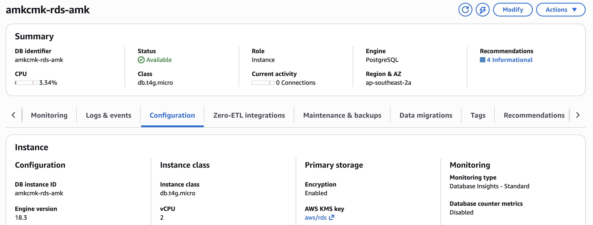
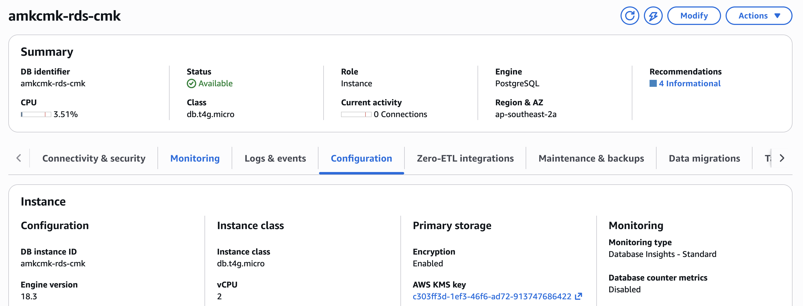

# How Clumio works with AWS-managed keys

Clumio never needs the key. It needs your data decrypted by the AWS service that owns it, inside your account. AWS allows exactly that, and AWS's own audit log shows Clumio doing it.

"Obtain the key" can mean five different things. Only the last one is what a backup tool needs, and AWS allows it by design.

| # | "Obtain the key" means... | Does Clumio need it? | What AWS says, and what we saw |
|---|---|---|---|
| 1 | Export the key material | **No.** Nobody can, for any KMS key. Decryption happens inside AWS | n/a |
| 2 | Be added to the key's policy | **No.** AWS writes an AWS-managed key's policy and nobody can edit it. It already admits every role in the account, through the owning service | `policy-aws-managed-key.json`: `Principal: *`, only if `kms:ViaService` is `s3.` or `rds.<region>` and `kms:CallerAccount` is your account |
| 3 | Use the key from Clumio's own account | **No.** AWS forbids it. Clumio's role runs in **your** account | CloudTrail: every Clumio call is a session of the role `ClumioIAMRole` in your account |
| 4 | Share an AWS-managed-key snapshot with another account | **No.** AWS forbids it, and Clumio never does it. It copies the snapshot under a key it can share, and shares only the copy | CloudTrail: 0 shares of the AWS-managed snapshot; the re-encrypted copy is shared |
| 5 | Have a role in your account use the key through S3 or RDS | **Yes, and AWS allows it** | S3: KMS `Decrypt` with `aws/s3`, by Clumio's role. RDS: KMS `CreateGrant` on `aws/rds`, by Clumio's role |

## In AWS's own words

- **S3:** "AWS managed key (`aws/s3`) can be used as your KMS key for cross-account operations when the uploading and accessing IAM principals are from the same AWS account." (Amazon S3 User Guide, SSE-KMS)
- **EBS:** "By default, all principals in the account have access to the default AWS managed KMS key for Amazon EBS, and they can use it for EBS encryption and decryption operations." (Amazon EBS User Guide, direct APIs)
- **RDS:** "You can't share a snapshot that has been encrypted using the default KMS key of the AWS account that shared the snapshot." (Amazon RDS User Guide). This is the rule row 4 is about: Clumio doesn't share that snapshot.

## What we ran (S3 and RDS, Sydney and Singapore)

| | AWS-managed key | Customer-managed key |
|---|---|---|
| S3 object | `aws/s3`: backed up, restored byte for byte, restored into another Region | our key: same |
| RDS database | `aws/rds`: backed up, restored in Sydney and into Singapore | our key: backed up, restored in Sydney |
| EC2 instance | `aws/ebs`: backed up; restored encrypted under `aws/ebs` when its key id is named in the restore | our key: backed up; restored encrypted under it |

`KeyManager = AWS` and the reserved alias `alias/aws/<service>` identify the AWS-managed keys. AWS sets both, and we cannot.




## Check it yourself (read-only)

```
scripts/demo-proof.sh            keys, the RDS snapshot sequence, S3 Decrypt events, who made each call
scripts/show-role.sh             what Clumio's role may do, how it is scoped, and the sessions you will see
```
or with the AWS CLI:
```
aws kms describe-key --key-id alias/aws/rds --query KeyMetadata.KeyManager        # AWS
aws kms get-key-policy --key-id <that key id> --policy-name default               # the policy AWS wrote
aws cloudtrail lookup-events --lookup-attributes AttributeKey=EventName,AttributeValue=Decrypt
aws cloudtrail lookup-events --lookup-attributes AttributeKey=EventName,AttributeValue=ModifyDBSnapshotAttribute
```
Every proof file is in `evidence/` with a checksum, and `PROOF.md` maps each claim to its files.
